# Informe de benchmarking: API de órdenes con NestJS + PostgreSQL

**Autor:** Rafael Potes
**Stack:** Node.js 22 + NestJS 10 + PostgreSQL 16 (Docker)
**Fecha:** 20 de noviembre de 2026

## 1. Descripción del microservicio

El servicio expone `POST /api/orders` (puerto 5001). Recibe un `customerId` y una lista de `items` (`productId`, `quantity`, `price`) y hace lo siguiente:

- Calcula `totalAmount` = Σ(`quantity` × `price`), redondeado a 2 decimales, e `itemsCount` = Σ(`quantity`).
- Genera un `orderId` con formato `ORD-<uuid>`.
- Abre una transacción (`BEGIN` / `COMMIT`, con `ROLLBACK` si algo falla) sobre una conexión del pool de `pg`: inserta la fila en `orders` (devolviendo `created_at`) y luego **todos** los ítems en `order_items` con un único `INSERT` multi-`VALUES` parametrizado.
- Responde HTTP 201 con el resumen. Si falta `customerId` o `items`, responde 400.

Prueba manual con el cuerpo exacto del enunciado (`C123`, `P1` 2 × 10.5, `P2` 1 × 5.0). Respuesta (HTTP 201):

```json
{"orderId":"ORD-6a2f34c7-8212-4092-9b7d-7aa74ba64104","customerId":"C123","totalAmount":26,"itemsCount":3,"processedAt":"2026-11-20T18:47:20.504Z"}
```

Verificación en Postgres de esa orden: 1 fila en `orders` (`total_amount = 26.00`, `items_count = 3`) y 2 filas en `order_items`. La salida completa de la petición y de los `SELECT` está en [`evidencias/resultados/verificacion_endpoint.txt`](evidencias/resultados/verificacion_endpoint.txt).

El cuerpo que usa JMeter (2 × 15.50 + 1 × 25.00) da `totalAmount` 56 e `itemsCount` 3.

Archivos principales: `api/src/main.ts`, `app.module.ts`, `orders.controller.ts` (validación y cálculos) y `database.service.ts` (pool de 30 conexiones y transacción).

## 2. Base de datos y docker-compose

- `init.sql` crea las tablas `orders` (`id`, `order_id` único, `customer_id`, `total_amount NUMERIC(10,2)`, `items_count`, `created_at`) y `order_items` (`id`, `order_id`, `product_id`, `quantity`, `price`). Se ejecuta automáticamente al crear el volumen.
- `docker-compose.yml` levanta dos servicios:

| Servicio | Contenedor | Imagen | Puerto host |
|---|---|---|---|
| api | `node-api-orders` | build de `./api` (Node 22 Alpine, multi-stage) | 5001 |
| db | `node-db-orders` | `postgres:16` | 5434 (→ 5432) |

La API espera a que Postgres pase el healthcheck (`pg_isready`) antes de arrancar. Los datos viven en el volumen `dbdata`.

## 3. Entorno de pruebas

| Componente | Detalle |
|---|---|
| SO | Windows 11 Pro |
| CPU / RAM | AMD Ryzen 5 8640HS (6 núcleos / 12 hilos), 36 GB |
| Docker | Docker 29.9.3 sobre Docker Desktop con WSL2 (kernel 6.6.87.2), 12 CPUs y ~17.5 GiB asignados |
| JMeter | 5.6.3 sobre Java 25 (Temurin), heap `-Xms1g -Xmx4g` en modo GUI |
| API | Node v22.23.5, NestJS 10.4.22, pg 8.23.1 (versiones instaladas en la imagen usada) |
| Base de datos | PostgreSQL 16.15 |

JMeter corre en el mismo equipo Windows que los contenedores, así que **compite por CPU** con la API y la base de datos. `htop` se ejecutó en un contenedor con `--pid=host`, por lo que muestra los procesos de la VM de Docker/WSL2 (`node dist/main.js`, `postgres`). Solo hubo un API levantado durante las pruebas.

## 4. Test Plan de JMeter (`jmeter/Benchmark.jmx`)

```
Benchmark NestJS (Test Plan)
├── setUp Thread Group
│   └── Limpiar tablas (TRUNCATE)   -> docker exec node-db-orders psql ... TRUNCATE TABLE order_items, orders RESTART IDENTITY;
├── Thread Group "NestJS (5001)"
│   ├── HTTP Request Defaults       (localhost, puerto ${__P(port,5001)}, /api/orders)
│   ├── HTTP Header Manager         (Content-Type: application/json)
│   └── HTTP Request "POST /api/orders"
├── Summary Report
├── Aggregate Report
└── Simple Data Writer              (archivo ${__P(jtl,)})
```

Parámetros del Thread Group, configurables con `-J`:

| Propiedad | Uso | Valor por defecto |
|---|---|---|
| `users` | hilos (usuarios) | 10 |
| `rampup` | ramp-up en segundos | 5 |
| `duration` | duración del scheduler en segundos | 30 |
| `port` | puerto de la API | 5001 |
| `jtl` | archivo de salida del Simple Data Writer | vacío |

En las corridas oficiales se usó duración de **60 s** y ramp-up de **10 s**. El sampler tiene timeout de conexión de 5 s, timeout de respuesta de 10 s y keep-alive activo. El `setUp Thread Group` hace `TRUNCATE ... RESTART IDENTITY` antes de cada corrida, así todas empiezan con tablas vacías.

Cuerpo del POST:

```json
{
  "customerId": "CUST-${__Random(1,1000)}",
  "items": [
    { "productId": "PROD-${__Random(1,50)}", "quantity": 2, "price": 15.50 },
    { "productId": "PROD-${__Random(51,100)}", "quantity": 1, "price": 25.00 }
  ]
}
```

## 5. Resultados por escenario

Los escenarios son 10 / 50 / 100 usuarios, como pide la sección de entregables del enunciado. El punto 5 del enunciado menciona 20/70/150, pero se siguió la sección de entregables. El cuarto escenario es el nivel de estrés encontrado (sección 6).

Las cifras salen del JTL de la misma corrida (procesado con `scripts/jtl_stats.py`) y coinciden con el Aggregate Report de las capturas (el promedio se trunca a milisegundos enteros, igual que JMeter). Cada corrida duró 60 s.

| Escenario | Usuarios | Muestras | Average (ms) | P90 (ms) | P95 (ms) | P99 (ms) | Min (ms) | Max (ms) | Throughput (req/s) | % Error | Observaciones personales |
|---|---|---|---|---|---|---|---|---|---|---|---|
| Baja | 10 | 38009 | 14 | 22 | 27 | 33 | 4 | 106 | 634.43 | 0.00 | Latencia mínima y estable (desv. est. 5.85 ms). Con solo 10 usuarios la API ya consumía ~96 % de un núcleo, o sea que el event loop ya estaba casi saturado. |
| Media | 50 | 43867 | 62 | 78 | 84 | 101 | 4 | 208 | 731.03 | 0.00 | El throughput subió solo un 15 % frente a 10 usuarios, pero la latencia se multiplicó por ~4. Ya se nota que el sistema no escala con más usuarios. |
| Alta | 100 | 43746 | 125 | 151 | 163 | 196 | 6 | 283 | 727.54 | 0.00 | Mismo throughput que con 50 usuarios y latencia el doble (125 ms). Es la meseta: las peticiones extra solo hacen cola. Cero errores. |
| Estrés | 1500 | 41781 | 2025 | 2119 | 2783 | 9107 | 77 | 10005 | 663.01 | 0.80 | Latencia promedio de ~2 s, con cola larga (P99 de 9.1 s, máximo 10 s). Aparecen errores por timeout de respuesta; el throughput baja a 663 req/s. |

## 6. Búsqueda del punto de estrés

**Método.** El enunciado sugiere subir de 20 en 20 hasta notar estrés. Partiendo de 100 eso habría tomado decenas de corridas, así que se hizo en dos pasos con sondas headless de 30 s (ramp-up 10 s, `scripts/probe.ps1`):

1. **Estimación.** El throughput se aplana en ~700 req/s desde 50 usuarios. Por la ley de Little, latencia promedio ≈ usuarios / throughput (≈ 1 s con 700 usuarios, ≈ 2 s con 1500). Los timeouts no los provoca el promedio sino la cola de la distribución: bajo saturación, el P99 se aleja varias veces del promedio. Por eso se estimó que las primeras peticiones cruzarían el timeout de 10 s cuando el promedio rondara 2-3 s, es decir, entre 1500 y 2000 usuarios. Se probó una exploración gruesa con 500, 1500 y 3000.
2. **Refinamiento en múltiplos de 20** alrededor de la zona de interés (2000, 2400, 1760, 1620, 1560, 1520, 1540, 1500 repetida, 1400, 1460, 1420 y 1440).

Resultados completos (`evidencias/busqueda_estres/busqueda_estres.csv`), en el orden ejecutado. Todas las sondas duraron 30 s:

| # | Usuarios | Muestras | Average (ms) | P90 (ms) | P95 (ms) | Throughput (req/s) | % Error | Errores 5xx | Errores socket timeout |
|---|---|---|---|---|---|---|---|---|---|
| 1 | 500 | 21565 | 590 | 716 | 732 | 703.61 | 0.00 | 0 | 0 |
| 2 | 1500 | 22524 | 1732 | 2060 | 2832 | 699.61 | 0.00 | 0 | 0 |
| 3 | 3000 | 24700 | 3405 | 10002 | 10002 | 674.72 | 14.55 | 0 | 3594 |
| 4 | 2000 | 22276 | 2416 | 5303 | 8730 | 666.67 | 4.00 | 0 | 892 |
| 5 | 2400 | 22273 | 2997 | 9642 | 10002 | 620.90 | 9.68 | 0 | 2156 |
| 6 | 1760 | 22181 | 2081 | 2430 | 5984 | 681.44 | 1.47 | 0 | 327 |
| 7 | 1620 | 22563 | 1901 | 2196 | 4485 | 698.67 | 0.98 | 0 | 220 |
| 8 | 1560 | 22892 | 1812 | 2120 | 3022 | 712.30 | 0.49 | 0 | 112 |
| 9 | 1520 | 21871 | 1807 | 2169 | 3230 | 678.13 | 0.04 | 0 | 8 |
| 10 | 1540 | 21773 | 1910 | 2548 | 4168 | 663.18 | 0.82 | 0 | 178 |
| 11 | 1500 | 21178 | 1842 | 2226 | 3399 | 659.13 | 0.27 | 0 | 58 |
| 12 | 1400 | 22420 | 1637 | 1935 | 2011 | 703.31 | 0.00 | 0 | 0 |
| 13 | 1460 | 21876 | 1742 | 2077 | 2836 | 681.73 | 0.01 | 0 | 2 |
| 14 | 1420 | 21349 | 1748 | 2079 | 2932 | 664.81 | 0.01 | 0 | 3 |
| 15 | 1440 | 22344 | 1687 | 2019 | 2436 | 696.31 | 0.00 | 0 | 0 |

**Conclusión.** Hay una zona de transición entre 1420 y 1500 usuarios. 1400 y 1440 dieron 0 % de error, 1420 y 1460 dieron 0.01 % (2-3 errores) y 1500 dio 0 % en una corrida y 0.27 % en otra. Entre 1520 y 1560 los errores ya aparecen en todas las sondas (0.04-0.82 %, con variación entre corridas), y de ahí en adelante crecen con claridad: 1.47 % a 1760, 4 % a 2000, 9.68 % a 2400 y 14.55 % a 3000. Se eligió **1500 usuarios** como nivel de estrés oficial porque marca el final de la zona de transición: por debajo, los errores son aislados (2-3 peticiones entre ~22 000) o nulos, y a partir de ahí dejan de ser anecdóticos. La frontera exacta no es un número fijo; depende de la variación entre corridas. En la corrida oficial de 60 s con GUI dio **0.80 %** de error (la sonda de 30 s dio 0.27 %; la corrida oficial dura el doble y acumula más peticiones encoladas).

Todos los errores son `SocketTimeoutException: Read timed out`, es decir, el timeout de respuesta de 10 s del cliente. **Hubo cero errores 5xx**: la API nunca devolvió un error, las respuestas tardaron más de 10 s. Al terminar la corrida oficial, la tabla `orders` tenía 41 781 filas, exactamente el número de peticiones enviadas (41 445 con 201 y 336 con timeout). Es decir, la API completó y guardó todos los pedidos, incluidos los que el cliente dio por perdidos: no hubo pérdida de datos, solo respuestas tardías.

## 7. Consumo del sistema

Se muestreó `docker stats` de forma continua durante cada corrida. El promedio y el máximo consideran solo las muestras con la API bajo carga (CPU API > 5 %). El CPU % de `docker stats` es relativo a 1 núcleo (100 % = 1 núcleo completo). Fuente: `evidencias/resultados/resources_report.csv`, calculado con `scripts/resources.py` a partir del monitoreo continuo (una lectura de `docker stats` cada ~2 s) guardado en `evidencias/raw/<usuarios>_docker_stats.csv`. Las capturas de `docker stats` y `htop` de la sección 9 son instantáneas tomadas a mitad de cada corrida.

| Escenario | Usuarios | CPU API % (prom / máx) | RAM API MiB (prom / máx) | CPU DB % (prom / máx) | RAM DB MiB (prom / máx) | Muestras | Observaciones |
|---|---|---|---|---|---|---|---|
| Baja | 10 | 96.4 / 118.2 | 66.4 / 68.7 | 59.6 / 79.6 | 94.8 / 104.0 | 30 | La API ya está en ~1 núcleo con solo 10 usuarios. La RAM de ambos es baja. |
| Media | 50 | 102.0 / 109.2 | 104.8 / 111.8 | 72.5 / 85.3 | 135.2 / 145.9 | 30 | La API se queda en ~100 %. La CPU de la DB sube un poco, en línea con el mayor ritmo de inserts. |
| Alta | 100 | 105.5 / 152.2 | 99.3 / 111.5 | 72.2 / 83.4 | 139.7 / 145.4 | 30 | Igual que 50 usuarios: la CPU de la API no pasa mucho de 1 núcleo. El máximo de 152 % fue un pico puntual. |
| Estrés | 1500 | 106.5 / 148.8 | 160.2 / 194.6 | 67.4 / 81.7 | 142.9 / 144.7 | 32 | La API sigue en ~1 núcleo y la RAM sube a 160-195 MiB, algo esperable con 1500 sockets abiertos y peticiones pendientes en memoria. La CPU de la DB no sube respecto a 50-100 usuarios. |

## 8. Análisis y observaciones

- **Cuello de botella en la API.** Node.js ejecuta el JavaScript en un solo hilo (event loop). En `htop` se ve `node dist/main.js` al ~100 % de un núcleo, y `docker stats` marca ~100-105 % de CPU de la API desde los 10 usuarios. El parseo del JSON, Express/Nest y el driver `pg` consumen ese único hilo. Postgres, que sí reparte el trabajo en varios procesos, se queda en ~60-73 % de CPU en promedio con núcleos libres en la máquina, y su consumo no crece de 50 a 1500 usuarios. Todo indica que el límite está en el hilo de la API y no en la base de datos. No se midió el tiempo de espera por una conexión del pool de `pg` (máximo 30), que es la otra cola posible.
- **Meseta de throughput.** El throughput se estanca en ~630-730 req/s (634 con 10 usuarios, 731 con 50, 728 con 100, 663 con 1500). Más usuarios no dan más peticiones por segundo.
- **Latencia lineal con los usuarios.** Como el throughput es casi constante, la latencia sube proporcional a los usuarios (ley de Little): 14 ms con 10, 62 ms con 50, 125 ms con 100 y ~2 s con 1500.
- **Tipo de errores.** Todos son *Read timed out* del cliente a los 10 s, sin ningún 5xx. Es saturación por encolamiento y no un fallo de la lógica ni de la base de datos.
- **Memoria.** Baja y estable: la API pasa de 66 a 160 MiB promedio y la DB de 95 a 143 MiB. La memoria no limita nada en estas pruebas.
- **Posibles mejoras (no implementadas).** Usar `cluster` o PM2 con varios workers por núcleo, cambiar Express por Fastify en el adaptador de Nest, o poner varias réplicas de la API detrás de un balanceador.
- **Limitaciones de la medición.**
  - JMeter (GUI, con heap de hasta 4 GB) corre en el mismo equipo y compite por CPU con los contenedores.
  - `docker stats` y las capturas de `htop` son de una sola máquina con Docker sobre WSL2, y el cliente no es independiente.
  - Las capturas de la carga (`pantalla_completa` y `jmeter_ejecutando`) se tomaron a mitad de la corrida (~35-40 s). Por eso el Summary Report visible ahí a 1500 usuarios es parcial; el resultado final es `1500u_summary_report.png`.
  - Cada nivel se corrió una vez; hay variación entre corridas, como se vio en 1500 (0.27 % frente a 0.80 %).

## 9. Evidencias

Todas las rutas son relativas a esta carpeta.
### Baja (10 usuarios)

- [Docker stats](evidencias/capturas/10u_docker_stats.png) · [htop](evidencias/capturas/10u_htop.png) · [JMeter ejecutando](evidencias/capturas/10u_jmeter_ejecutando.png) · [Summary Report](evidencias/capturas/10u_summary_report.png) · [Aggregate Report](evidencias/capturas/10u_aggregate_report.png) · [Pantalla completa](evidencias/capturas/10u_pantalla_completa.png)

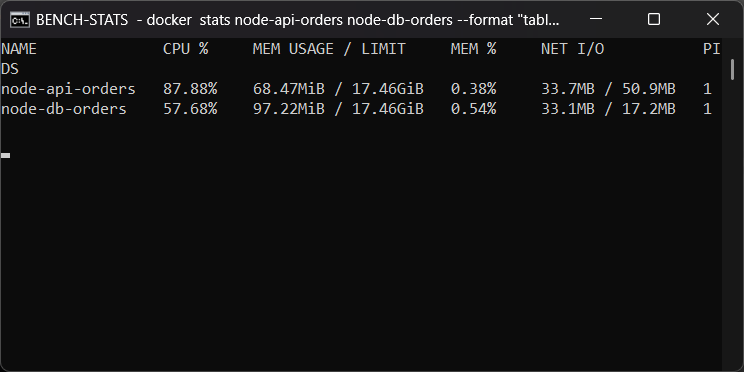

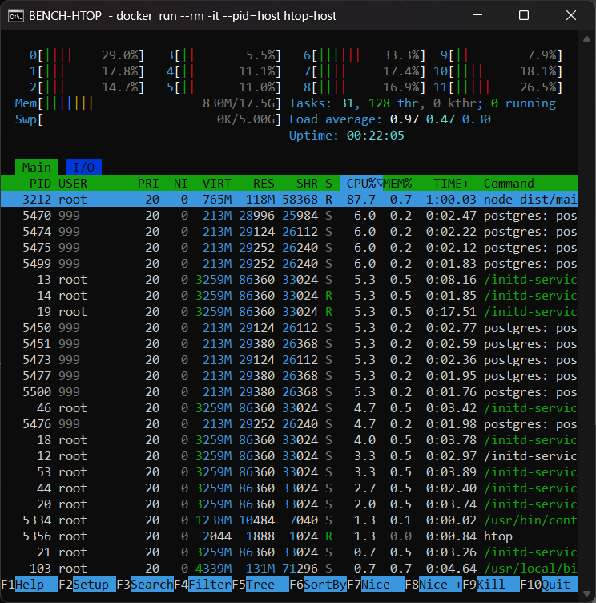

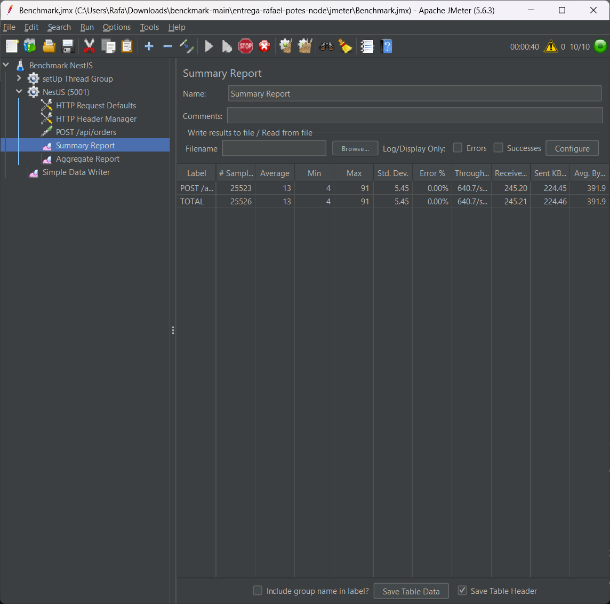


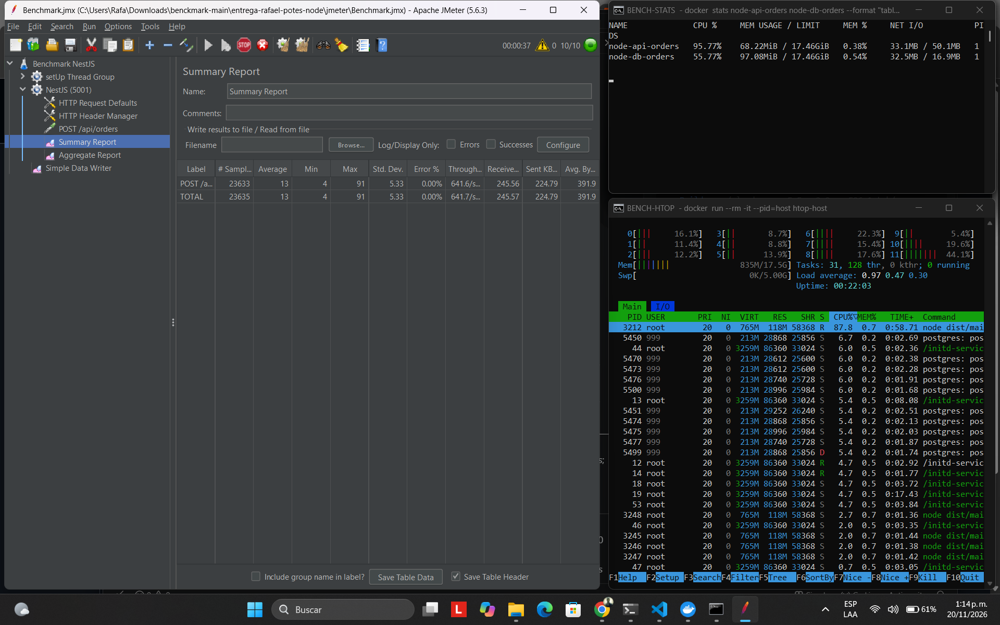

### Media (50 usuarios)

- [Docker stats](evidencias/capturas/50u_docker_stats.png) · [htop](evidencias/capturas/50u_htop.png) · [JMeter ejecutando](evidencias/capturas/50u_jmeter_ejecutando.png) · [Summary Report](evidencias/capturas/50u_summary_report.png) · [Aggregate Report](evidencias/capturas/50u_aggregate_report.png) · [Pantalla completa](evidencias/capturas/50u_pantalla_completa.png)

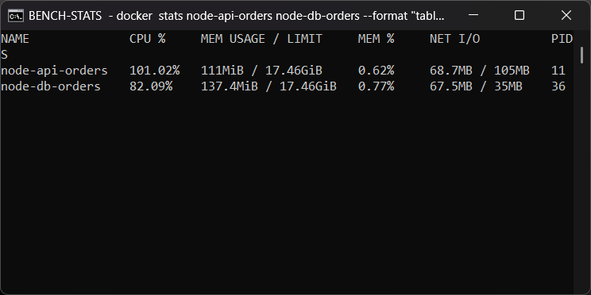

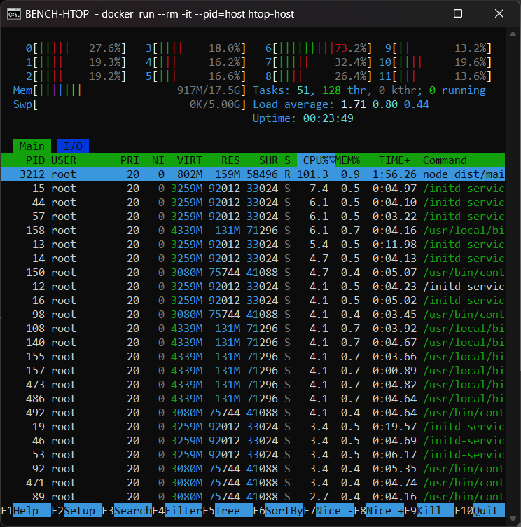


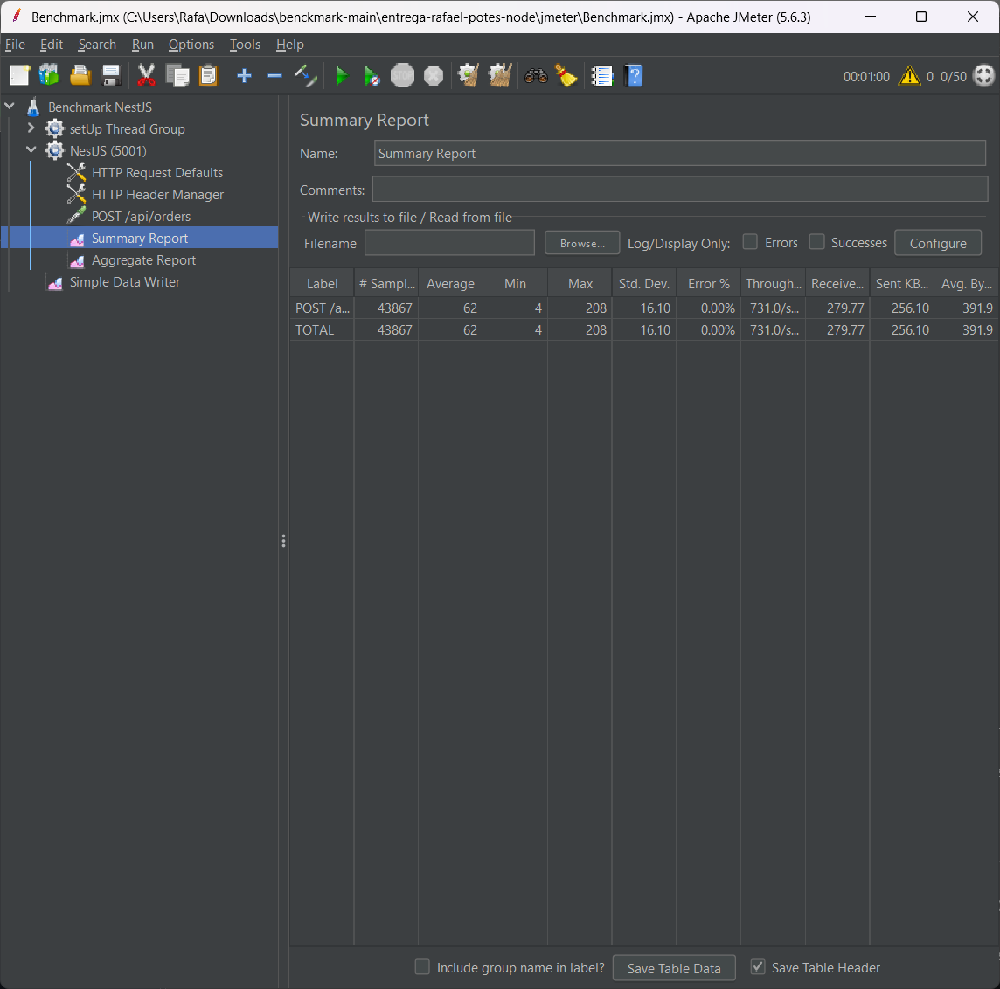


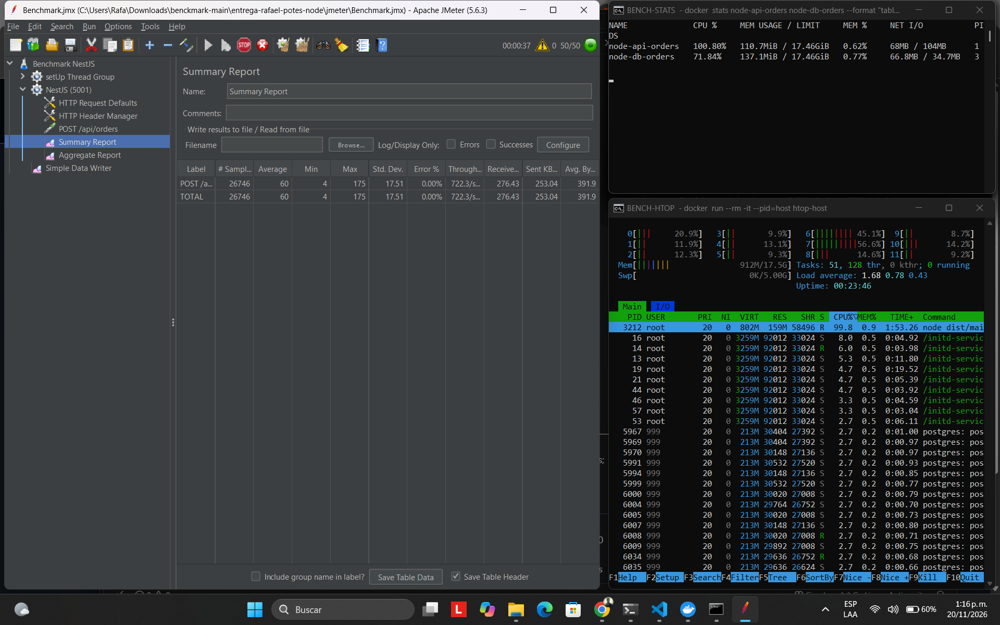

### Alta (100 usuarios)

- [Docker stats](evidencias/capturas/100u_docker_stats.png) · [htop](evidencias/capturas/100u_htop.png) · [JMeter ejecutando](evidencias/capturas/100u_jmeter_ejecutando.png) · [Summary Report](evidencias/capturas/100u_summary_report.png) · [Aggregate Report](evidencias/capturas/100u_aggregate_report.png) · [Pantalla completa](evidencias/capturas/100u_pantalla_completa.png)

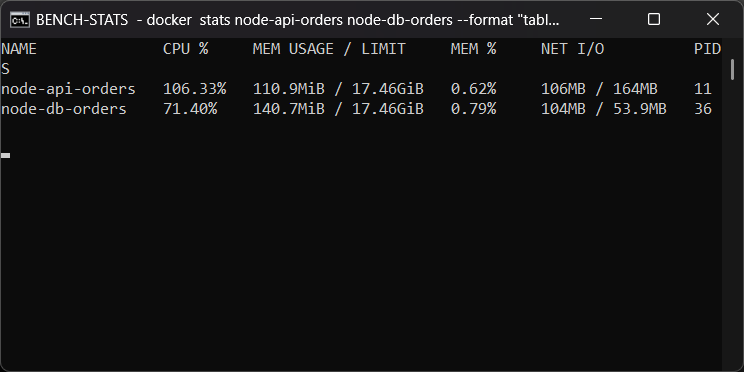

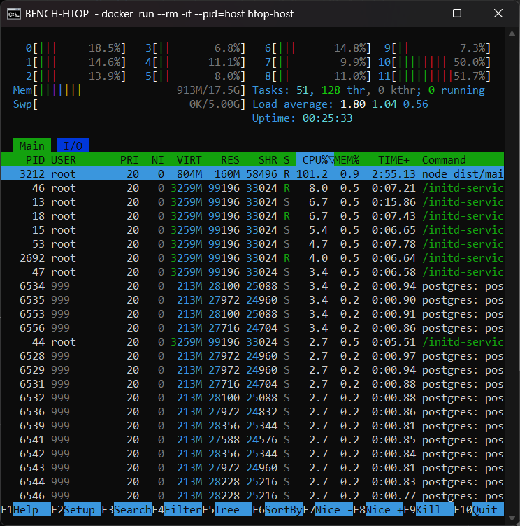


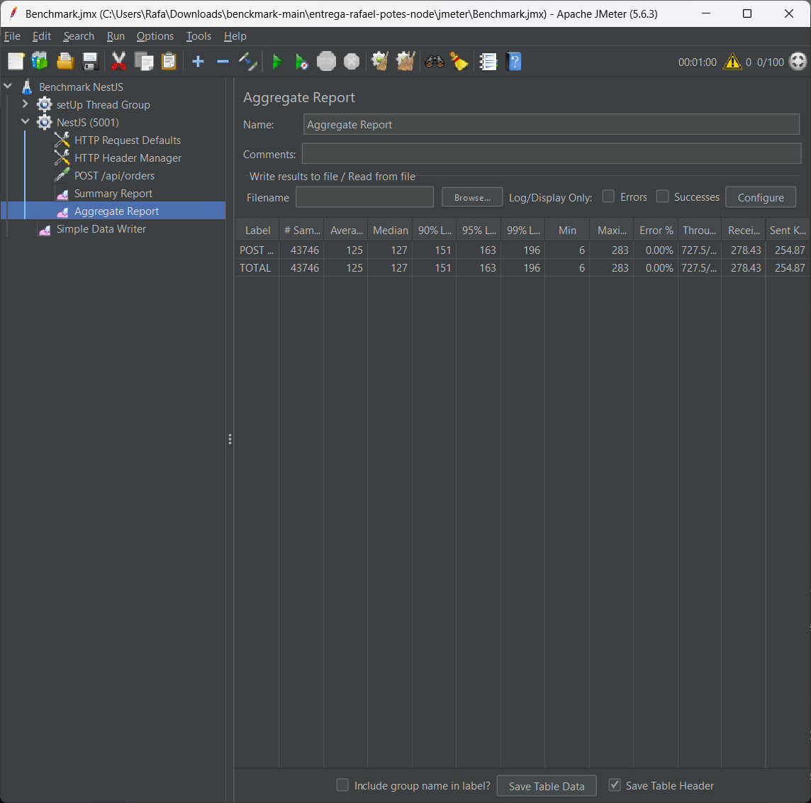

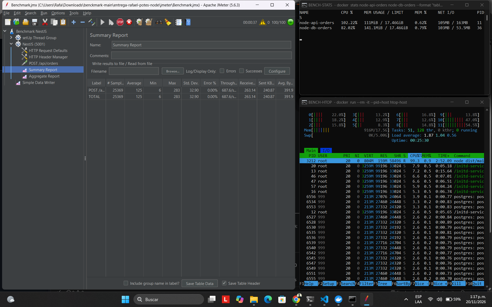

### Estrés (1500 usuarios)

- [Docker stats](evidencias/capturas/1500u_docker_stats.png) · [htop](evidencias/capturas/1500u_htop.png) · [JMeter ejecutando](evidencias/capturas/1500u_jmeter_ejecutando.png) · [Summary Report](evidencias/capturas/1500u_summary_report.png) · [Aggregate Report](evidencias/capturas/1500u_aggregate_report.png) · [Pantalla completa](evidencias/capturas/1500u_pantalla_completa.png)

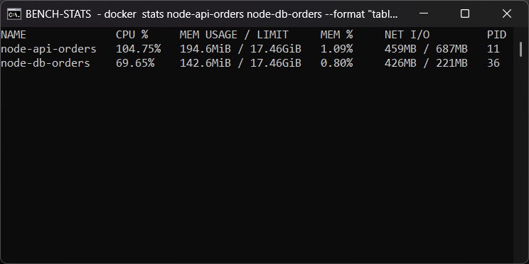

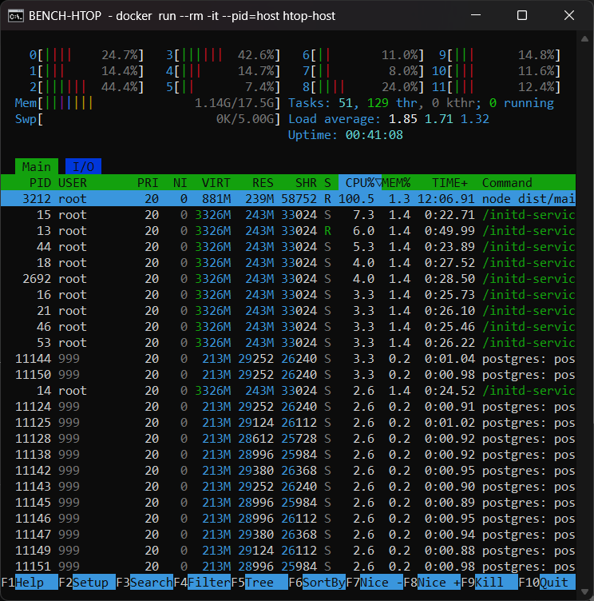


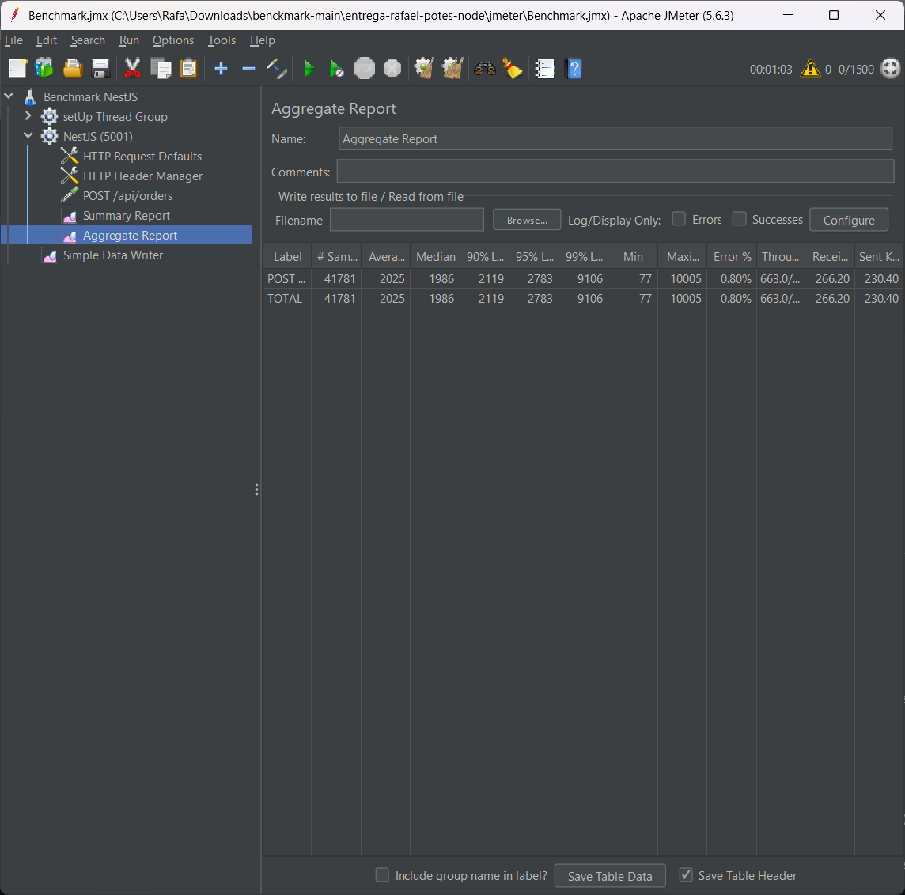

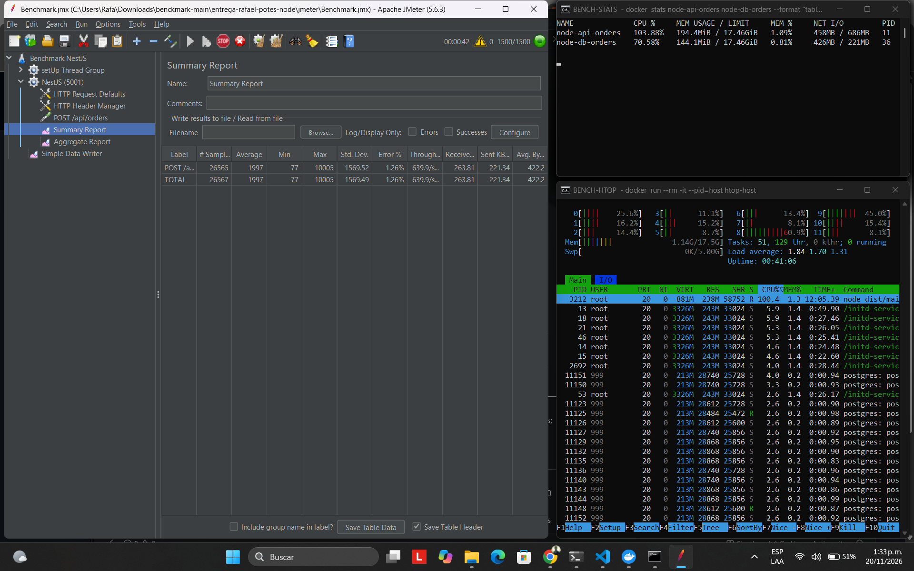

### Contenedores en ejecución

[docker ps](evidencias/capturas/docker_ps.png)

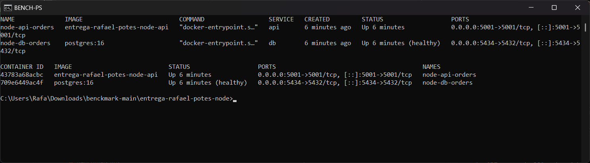

## 10. Fila para la tabla comparativa grupal

| Stack | Baja (10) Avg / P95 / Thr / %Err | Media (50) Avg / P95 / Thr / %Err | Alta (100) Avg / P95 / Thr / %Err | Estrés (1500) Avg / P95 / Thr / %Err |
|---|---|---|---|---|
| NestJS (Node) | 14 ms / 27 ms / 634.43 req/s / 0.00 % | 62 ms / 84 ms / 731.03 req/s / 0.00 % | 125 ms / 163 ms / 727.54 req/s / 0.00 % | 2025 ms / 2783 ms / 663.01 req/s / 0.80 % |